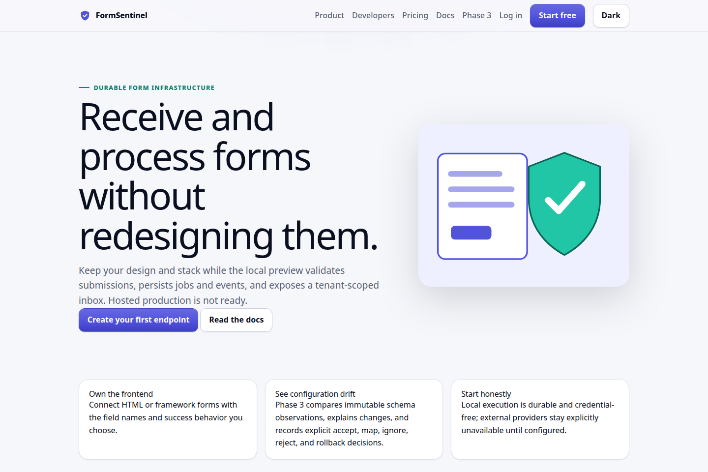
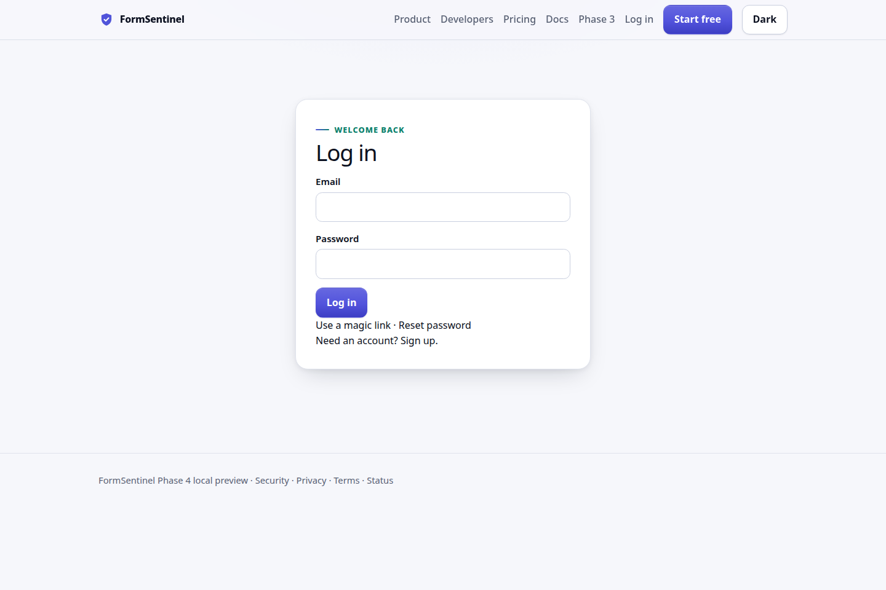

# FormSentinel

Form infrastructure with a security-first design: public submission ingest, spam and abuse defence, schema-drift detection, signed webhooks, and an MCP server — built as a pnpm/Turborepo monorepo in TypeScript.

> **Status — read this first.** FormSentinel is under active development and is **not production-ready**. Locally, the Phase 2 submission pipeline (ingest → queue → processing → storage) works against PostgreSQL, and the Phase 3/4 package suites (network policy, scanner, schema-drift, entitlements, billing contracts, abuse, privacy, observability) run as tested contracts. Hosted production is deliberately blocked: the PostgreSQL web auth/control-plane and managed storage/KMS/scanner adapters are not implemented, production fallbacks refuse rather than degrade silently, and every local adapter honestly reports `captured_local` instead of claiming provider delivery. See [docs/architecture.md](./docs/architecture.md) for the exact boundaries.

## Screenshots

The web app — tenant operations for the form platform:



Sign in to the operations dashboard:



## Services

| App            | Role                                                              |
| -------------- | ----------------------------------------------------------------- |
| `apps/web`     | Authenticated tenant operations and dashboard views               |
| `apps/ingest`  | Public submission endpoint                                        |
| `apps/worker`  | Leased job dispatch (scans, alerts, webhooks, reports, analytics) |
| `apps/scanner` | Bounded static HTML scanning                                      |
| `apps/mcp`     | Scoped JSON-RPC / MCP tools server                                |

Every runtime exposes `/health`, `/ready` and `/version`.

## Packages

40+ packages under `packages/`, grouped by phase:

- **Submissions core** — `submissions`, `queue`, `storage`, `captcha`, `spam`, `email`, `webhooks`, `form-schema`, `validation`
- **Platform** — `auth`, `api-keys`, `entitlements`, `usage`, `billing`, `platform-admin`, `config`, `database`
- **Trust & safety** — `security`, `abuse`, `privacy`, `network-policy`, `reliability`, `monitoring`, `observability`
- **Intelligence** — `scanner`, `schema-drift`, `integration-copilot`, `integrations`, `routing`, `analytics`, `reports`, `agency`, `mcp-tools`, `phase3-store`
- **Client** — `@formsentinel/react`, `sdk`, `ui`, `test-console`, `testing`

## Requirements

- Node.js 22+
- pnpm 10.28.1 (pinned via `packageManager`; use Corepack)
- PostgreSQL for the Phase 2 submission pipeline

## Getting started

```bash
git clone https://github.com/MrRandom-0/FormSentinel.git
cd FormSentinel
corepack enable
pnpm install
pnpm test            # vitest suites
pnpm typecheck       # turbo typecheck
pnpm lint            # eslint
```

Phase-specific suites: `pnpm test:phase2`, `pnpm test:phase3`, `pnpm test:phase4` (plus `:security` variants). The launch gate is `pnpm launch:verify`.

Deployment and environment details live in [docs/deployment.md](./docs/deployment.md), [docs/coolify.md](./docs/coolify.md) and [docs/environment.md](./docs/environment.md).

## Documentation

- [Architecture](./docs/architecture.md) — services, domain boundaries, the honest-adapter model
- [Development](./docs/development.md) · [Security](./docs/security.md) · [Scanner](./docs/scanner.md)
- [Webhooks](./docs/webhooks.md) · [MCP](./docs/mcp.md) · [OpenAPI](./docs/openapi.yaml)
- [Launch checklist](./docs/launch-checklist.md) · [Runbooks](./docs/runbooks.md)

## Design principles

- **Fail closed.** Unimplemented production paths refuse; they never fall back to memory or local files.
- **Honest adapters.** Local email, alerts and integrations report `captured_local`; official provider connections report `unavailable` until real credential adapters exist.
- **Deterministic checks.** Scanning, schema-drift and policy decisions are rule-based and test-covered, not vibes.
